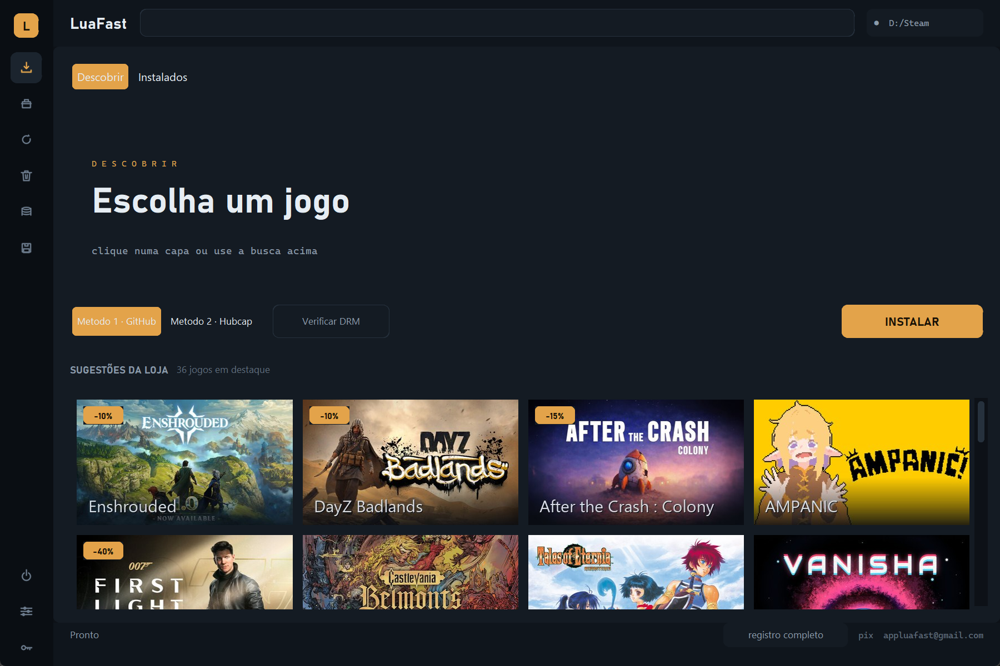
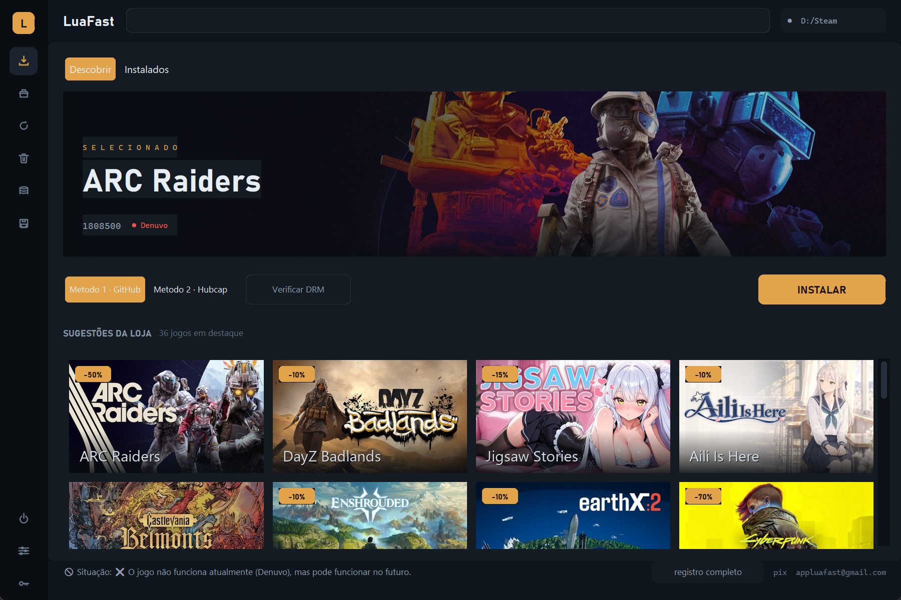
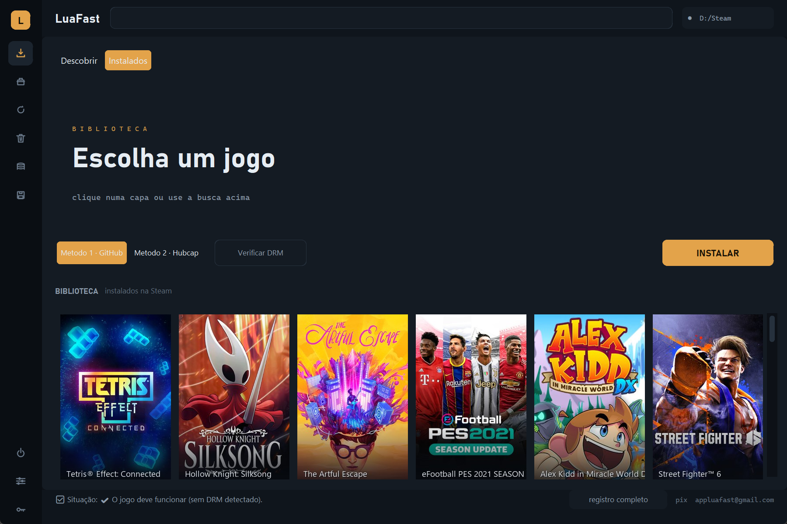
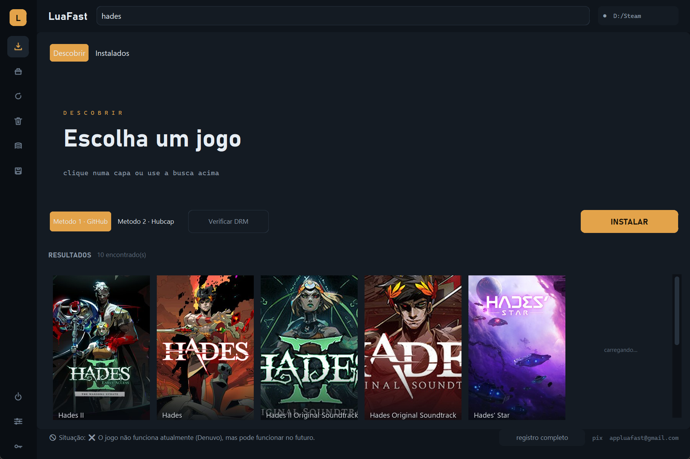
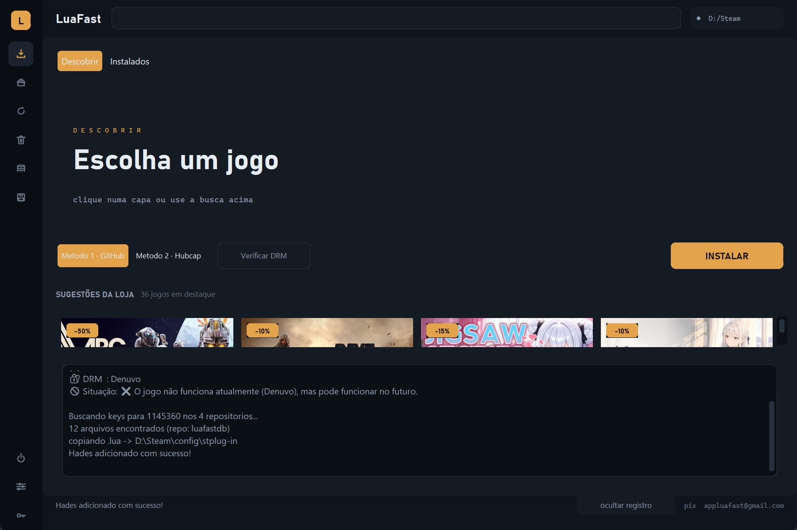
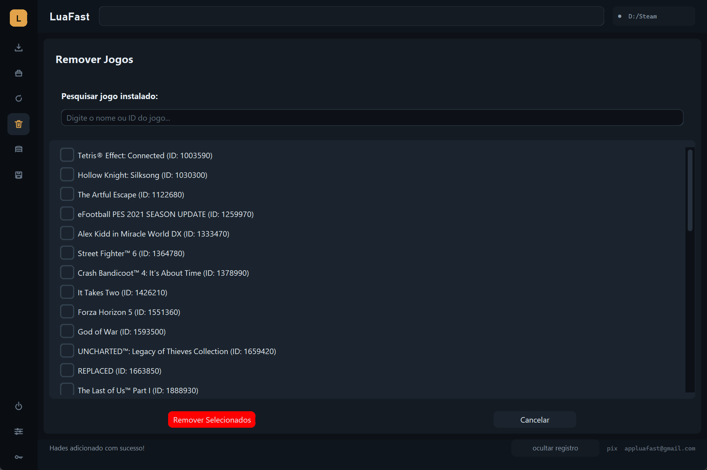
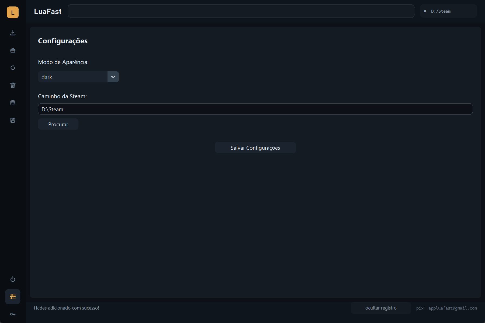

# LuaFast

**Gerenciador de biblioteca Steam para Windows.** Adiciona jogos à sua biblioteca
por meio de arquivos `.lua` e `.manifest`, no mesmo modelo do SteamTools.


---

## O que ele faz

O LuaFast escreve em duas pastas da sua instalação da Steam:

| Pasta | O que vai para lá |
|---|---|
| `Steam\config\stplug-in` | arquivos `.lua` — as "keys" (`addappid`) |
| `Steam\depotcache` | arquivos `.manifest` — depots e seus GIDs |

Com isso, os jogos aparecem na sua biblioteca e podem ser baixados normalmente.
Não há conexão externa durante o uso: só no momento de baixar os arquivos.

---

## Como é a interface

A tela principal tem duas abas.

**Descobrir** é a que abre. Mostra o que a loja está oferecendo — ofertas, mais
vendidos, lançamentos e jogos em breve, tudo numa grade só, com o desconto de
cada um.



Clique numa capa e a arte do jogo ocupa o topo, junto do AppID e do aviso de
DRM — assim você sabe antes de instalar se o jogo deve funcionar.



**Instalados** é a biblioteca: só os jogos que já estão na sua Steam, lidos dos
arquivos `.lua`.



A busca na barra superior funciona nas duas abas — digite e a grade vira os
resultados. Apagar o campo devolve a lista de onde você estava.



O registro completo fica numa gaveta no rodapé, para não poluir a tela.



<details>
<summary><b>Outras telas</b></summary>

<br>





</details>

---

## Recursos

### 🎮 Instalar jogos
Busque por nome ou AppID e o LuaFast baixa as keys e os manifests sozinho.
Dois servidores de origem:

- **Método 1 — GitHub:** busca em repositórios públicos de keys.
- **Método 2 — Hubcap API:** usa a API do [hubcapmanifest.com](https://hubcapmanifest.com)
  e exige um token de acesso (ver [Token Hubcap](#-token-hubcap)).

### 🧩 Instalar DLCs
Lista as DLCs disponíveis para um jogo já adicionado e instala as que você marcar.

### 🔄 Atualizar keys instaladas
Procura online por manifests mais novos e, quando encontra, baixa e atualiza o
`.lua` correspondente.

### 🗑️ Remover jogos
Remove da biblioteca os jogos que você selecionar — apaga o `.lua` e os
manifests associados.

### 💾 Backup das keys
Copia os `.lua` e `.manifest` para uma pasta de backup e restaura quando quiser.

### 📁 Save Games
Faz backup dos saves dos jogos instalados.

### ⏻ Reiniciar Steam
Fecha e reabre a Steam — necessário para que as mudanças apareçam na biblioteca.

### ⚙️ Configurações
Define a pasta da Steam e ajusta o tema da interface.

---

## Requisitos

- **Windows 10 ou 11**
- **Steam instalada**
- **Git instalado** — necessário para o Método 1, que clona os repositórios de
  keys. Se você não tem, baixe em <https://git-scm.com/download/win> e vá
  clicando em *Next* até o fim; não precisa configurar nada.

---

## Como usar

1. Baixe o `.exe` mais recente em **[Releases](../../releases/latest)**.
2. Abra o LuaFast. Na primeira vez, ele mostra os termos de uso.
3. Se a Steam não for encontrada automaticamente, vá em **Configurações** e
   aponte a pasta onde ela está instalada.
4. A tela inicial mostra a sua biblioteca. Use a busca para achar um jogo novo.
5. Depois de instalar, clique em **Reiniciar Steam** para aplicar.

> O app avisa sozinho quando houver uma versão nova publicada aqui.

---

## Token Hubcap

O Método 2 depende da API do hubcapmanifest.com, que usa token por conta:

1. Acesse <https://hubcapmanifest.com> e crie uma conta.
2. Gere uma API Key nas configurações do site.
3. No LuaFast, clique em **Token Hubcap** no menu lateral e cole o token.

O token fica salvo localmente, na pasta `log`.

---

## Compilando as DLLs

O LuaFast **já cria as DLLs automaticamente** dentro da pasta da Steam na
primeira execução. O que está aqui no repositório é o código-fonte delas, para
estudo e para quem quiser compilar do zero.

### Requisitos

- CMake 3.20+
- Visual Studio 2022 com MSVC (17.14.31 x64)

### Compilar

```
1. Execute build.bat a partir da raiz do projeto.
2. Ao final, as DLLs estarão em \build\Release
```

---

## Perguntas frequentes

**Preciso deixar a Steam fechada?**
Não para instalar. Mas as mudanças só aparecem na biblioteca depois de
reiniciar a Steam — o botão **Reiniciar Steam** faz isso.

**O jogo não apareceu na biblioteca.**
Reinicie a Steam. Se continuar, confira se o caminho configurado em
**Configurações** é o mesmo da Steam que você abre.

**O Método 1 não encontrou meu jogo.**
Ele busca em repositórios públicos, que não têm tudo. Tente o Método 2.

**Dá erro ao instalar o Método 1.**
Confira se o Git está instalado e acessível no PATH.

---

## Apoie o projeto

O LuaFast é **completamente gratuito** e não tem uso comercial. Se ele te ajuda
e você quiser retribuir:

**Pix:** `appluafast@gmail.com`

Qualquer valor ajuda a manter o projeto funcionando.

---

## Licença

Distribuído sob a **GPL-3.0**. As diretrizes abaixo são complementares à licença
e, em caso de conflito, prevalecem sobre ela:

- Durante o uso podem ser gerados dados protegidos por direitos autorais. O
  usuário deve excluí-los em no máximo 24 horas.
- É proibido usar o projeto para fins comerciais.
- Modificações só são permitidas com a publicação do código-fonte correspondente
  e menção aos criadores.

---

## Créditos

- **@blumenal** e **@jeffersonsud** — desenvolvimento
- [CreamInstaller](https://github.com/pointfeev) por **pointfeev**
